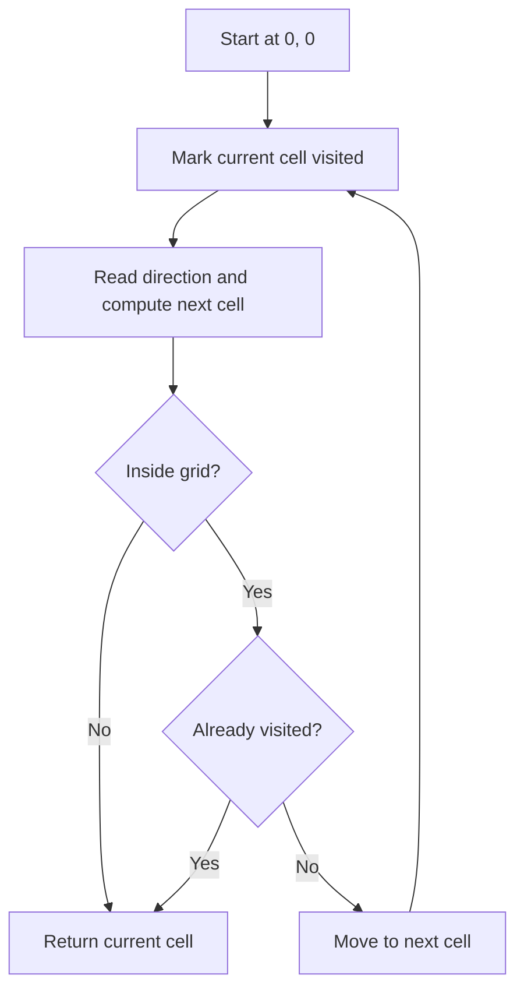
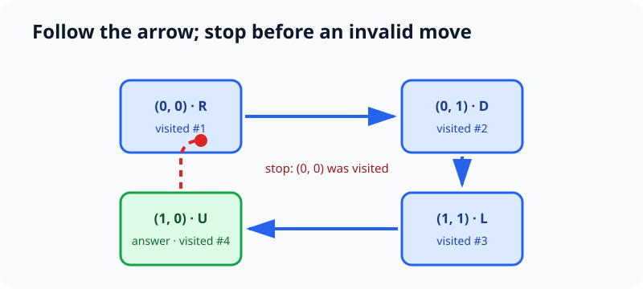

# Q2 — Last Visited Cell in a Directional Grid

> LeetCode 4084 · Medium · Simulation, Matrix

[Problem](https://leetcode.com/problems/last-visited-cell-in-a-directional-grid/) · [Python solution](./solution.py) · [Tests](./tests.py)

## Problem overview

Every cell in an `m × n` grid contains one direction: left, right, up, or down. We begin at `(0, 0)` and follow those directions. The walk stops *before* a move that would leave the grid or revisit a cell. We return the current cell—the final cell actually visited.

## Intuition

The statement already describes a deterministic process: from any cell there is exactly one proposed next cell. That makes direct simulation the natural first approach. The only state we must remember is which cells have been visited, because entering one of them is forbidden.

A subtle but important detail is the order of operations:

1. Mark the current cell visited.
2. Compute, but do not yet commit, the next coordinate.
3. If that coordinate is invalid or visited, return the current coordinate.
4. Otherwise move there and repeat.

## Brute-force starting point

One literal approach stores every visited coordinate in a list and scans the list before each move.

```python
def last_visited_cell_list(grid: list[list[str]]) -> list[int]:
    moves = {"L": (0, -1), "R": (0, 1), "U": (-1, 0), "D": (1, 0)}
    rows, cols = len(grid), len(grid[0])
    row = col = 0
    visited = []

    while True:
        visited.append((row, col))
        dr, dc = moves[grid[row][col]]
        nr, nc = row + dr, col + dc
        if not (0 <= nr < rows and 0 <= nc < cols) or (nr, nc) in visited:
            return [row, col]
        row, col = nr, nc
```

### Why this can be too slow

The path contains at most `m × n` cells, but `coordinate in visited` is a linear scan. A long path can therefore cost

`1 + 2 + ... + (m × n) = O((m × n)²)`.

The simulation is right; only the visited lookup needs improvement.

## Key observation

A Boolean matrix has the same shape as the grid and answers “have we visited this cell?” in `O(1)`. Once a cell is marked, the walk can never legally enter it again. Therefore, every successful move reaches a new cell and there can be at most `m × n` iterations.

## Optimized approach

The movement map keeps the coordinate arithmetic in one place:

| Symbol | Row change | Column change |
|:---:|---:|---:|
| `L` | 0 | -1 |
| `R` | 0 | +1 |
| `U` | -1 | 0 |
| `D` | +1 | 0 |

At each cell, derive `(next_row, next_col)`. Return the current coordinate if the next one is out of bounds or already marked; otherwise continue from the next coordinate.

<!-- publication-image: assets/path-simulation.svg -->




## Detailed dry run

For

```text
R D
U L
```

| Step | Current | Direction | Proposed next | Result |
|---:|:---:|:---:|:---:|---|
| 1 | `(0, 0)` | `R` | `(0, 1)` | move |
| 2 | `(0, 1)` | `D` | `(1, 1)` | move |
| 3 | `(1, 1)` | `L` | `(1, 0)` | move |
| 4 | `(1, 0)` | `U` | `(0, 0)` | already visited; stop |

The attempted fourth move is not performed, so the answer is `[1, 0]`.

## Final accepted Python 3 code

```python
class Solution:
    def lastVisitedCell(self, grid: list[list[str]]) -> list[int]:
        rows, cols = len(grid), len(grid[0])
        directions = {
            "L": (0, -1),
            "R": (0, 1),
            "U": (-1, 0),
            "D": (1, 0),
        }
        visited = [[False] * cols for _ in range(rows)]
        row = col = 0

        while True:
            visited[row][col] = True
            dr, dc = directions[grid[row][col]]
            next_row, next_col = row + dr, col + dc

            if not (0 <= next_row < rows and 0 <= next_col < cols):
                return [row, col]
            if visited[next_row][next_col]:
                return [row, col]

            row, col = next_row, next_col
```

The canonical executable version is in [`solution.py`](./solution.py).

## Complexity

- **Time — `O(mn)`:** each legal iteration marks a previously unvisited cell. There are only `m × n` cells.
- **Space — `O(mn)`:** the Boolean visited matrix contains one entry per cell.

## Edge cases and common mistakes

- A `1 × 1` grid always returns `[0, 0]`, regardless of its arrow.
- Test the *proposed* next coordinate before indexing the grid with it.
- Do not move into a repeated cell and then return it; return the previous cell.
- Mark the starting cell before following its arrow.
- Keep row and column deltas distinct: `U/D` change the row, while `L/R` change the column.

## FAQ

### Why must the process terminate?

Each successful move enters a new cell. After at most `m × n` visited cells, the next move must either leave the grid or repeat a cell.

### Could a set replace the matrix?

Yes. A set of `(row, column)` pairs also gives expected `O(1)` lookup and may use less memory on short paths. The matrix has predictable worst-case bounds and simple indexing.

### Can we modify the input grid to mark visits?

Yes if mutation is allowed, but a separate matrix keeps the function's input unchanged and the intent explicit.

## Key takeaways

- Deterministic movement problems are often direct simulations.
- When a correct simulation is slow, inspect the cost of each state lookup.
- Validate a proposed state transition before committing it.
- A monotonic invariant—“visited cells only increase”—gives both termination and complexity proofs.

## LeetCode-ready version

Generate the copy-ready Markdown, including public image URLs, from this canonical editorial:

```bash
python3 scripts/generate_publication.py \
  contests/leetcode/weekly/524/Q2-last-visited-cell/README.md
```
