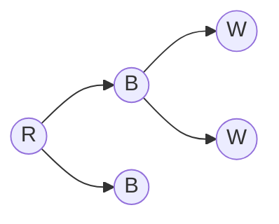
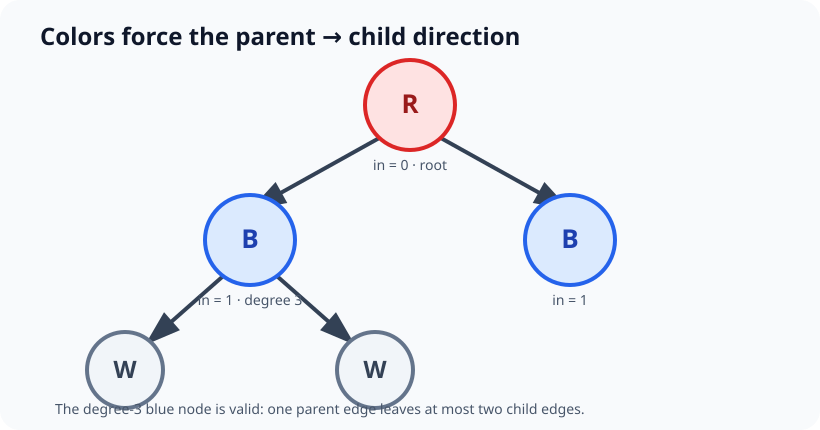

# Q3 — Find Root of a Colored Tree

> LeetCode 4085 · Medium · Trees, Graph Orientation, Indegree

[Problem](https://leetcode.com/problems/find-root-of-a-colored-tree/) · [Optimized solution](./solution.py) · [Brute force](./brute_force.py) · [Tests](./tests.py)

## Problem overview

We have an undirected tree whose nodes are colored `R`, `B`, or `W`. We must choose a root so that:

1. every node has at most two children; and
2. colors advance by depth in the repeating cycle `R → B → W → R`, starting from whichever color the root has.

Return any valid root, or `-1` if no root works. The input guarantees that every undirected degree is at most three.

## Intuition — begin with the definition

For a chosen root, breadth-first search exposes exactly the facts in the definition: depth, parent/child relationships, and each node's number of children. So the most direct solution is to try every node as the root and validate the resulting rooted tree.

This brute-force view is useful even though it is too slow. It reveals that every edge is checked for the same local rule repeatedly: a parent's color determines its child's color.

## Brute-force BFS

For every candidate root:

1. Create a **fresh** `visited` array.
2. Start BFS with the root's own color as the expected color at depth zero.
3. When processing a node, reject the candidate if its color is not the expected one.
4. Count unvisited neighbors as children; reject more than two.
5. Enqueue every child with the next expected color in the cycle.

```python
from collections import deque

AFTER = {"R": "B", "B": "W", "W": "R"}

def find_colored_root_brute_force(edges, colors):
    n = len(colors)
    graph = [[] for _ in range(n)]
    for u, v in edges:
        graph[u].append(v)
        graph[v].append(u)

    for root in range(n):
        visited = [False] * n  # reset for this root
        visited[root] = True
        queue = deque([(root, colors[root])])
        valid = True

        while queue and valid:
            node, expected = queue.popleft()
            if colors[node] != expected:
                valid = False
                break

            children = 0
            for neighbor in graph[node]:
                if visited[neighbor]:
                    continue
                visited[neighbor] = True
                children += 1
                queue.append((neighbor, AFTER[expected]))

            if children > 2:
                valid = False

        if valid:
            return root

    return -1
```

### Why `visited` must be reset

Visited means “already reached from the **current candidate root**.” Reusing it across candidates would make nodes appear processed before the next BFS begins, causing edges to be skipped and invalid roots to be accepted or valid roots to be rejected.

### Why brute force becomes `O(n²)`

One BFS touches all `n` nodes and `n - 1` edges, so it costs `O(n)`. In the worst case we try all `n` roots:

`n candidates × O(n) validation = O(n²)`.

## The observation that removes repeated BFS

Suppose adjacent nodes have colors `R` and `B`. If the edge points from parent to child, it can only be `R → B`, because `B` is the color after `R`. It cannot be `B → R`, because the color after `B` is `W`.

The same reasoning works for every pair of different colors. With exactly three colors in a directed cycle, an undirected edge's endpoint colors fix its only valid direction:

| Endpoint colors | Required direction |
|---|---|
| `R`, `B` | `R → B` |
| `B`, `W` | `B → W` |
| `W`, `R` | `W → R` |
| equal colors | impossible |

This direction does not depend on which root we try. We can orient every edge once.

<!-- publication-image: assets/edge-orientation.svg -->




## From orientation to the root

In any tree directed away from its root:

- the root has no parent, so its indegree is `0`;
- every other node has exactly one parent, so its indegree is `1`.

Therefore the oriented edges must produce exactly one indegree-zero node, and all other nodes must have indegree one.

### Why multiple root candidates are invalid

There are `n - 1` directed edges, so the sum of all indegrees is `n - 1`. If two nodes have indegree zero, the remaining `n - 2` nodes would need to absorb `n - 1` incoming edges. At least one would have indegree two, meaning it has two parents. That cannot happen in a rooted tree.

### Why the root's degree must be at most two

The root has no parent. Every incident edge therefore leads to a child, so `children(root) = degree(root)`. A root of degree three would have three children and violate the binary-tree rule.

### Why non-root nodes are automatically binary

The problem guarantees undirected degree at most three. A non-root node uses exactly one incident edge for its parent, leaving at most `3 - 1 = 2` edges for children. Once its indegree is confirmed to be one, no separate child-count test is needed.

## Optimized approach

1. Initialize `indegree` and undirected `degree` arrays.
2. For each edge `(u, v)`, compare the endpoint colors.
3. Direct the edge toward the endpoint whose color follows the other endpoint's color; increment that endpoint's indegree.
4. Reject equal-colored endpoints immediately.
5. Find all indegree-zero nodes. There must be exactly one.
6. Confirm every other node has indegree one.
7. Confirm the root's undirected degree is at most two.

The optimized algorithm is the brute-force logic with its repeated work factored out: BFS kept rediscovering parent-to-child edge directions, while colors already determine those directions globally.

## Detailed dry run

Consider:

```text
edges  = [[0,1], [0,2], [1,3], [1,4]]
colors = "RBBWW"
```

| Edge | Colors | Forced direction | Indegree changed |
|---|---|---|---|
| `0—1` | `R—B` | `0 → 1` | `in[1] = 1` |
| `0—2` | `R—B` | `0 → 2` | `in[2] = 1` |
| `1—3` | `B—W` | `1 → 3` | `in[3] = 1` |
| `1—4` | `B—W` | `1 → 4` | `in[4] = 1` |

Final indegrees are `[0, 1, 1, 1, 1]`. Node `0` is the unique root candidate and has degree two. Node `1` has degree three, but one edge is its parent edge, so it has only two children. The answer is `0`.

### Invalid multiple-candidate example

```text
0(R) — 1(B) — 2(R)
```

Both color pairs force arrows toward node `1`: `0 → 1 ← 2`. Nodes `0` and `2` both have indegree zero, while node `1` has indegree two. No single root can orient the tree this way, so the answer is `-1`.

## Correctness proof

We prove that the algorithm returns a node exactly when it is a valid root.

**Lemma 1 — Every valid edge direction is uniquely determined by its endpoint colors.**  
If a node has color `C`, each child must have `AFTER[C]`. For two distinct colors among a three-color cycle, exactly one endpoint is the successor of the other. Equal colors cannot be at adjacent depths. Thus each valid edge has one possible direction.

**Lemma 2 — If the algorithm accepts root `r`, the oriented tree is rooted at `r`.**  
The accepted node `r` has indegree zero and every other node has indegree one. The underlying graph is a connected tree, and all its `n - 1` edges are oriented. Following parent edges backward cannot cycle because the underlying graph is acyclic; it must end at the only indegree-zero node, `r`. Hence all edges point away from `r`.

**Lemma 3 — An accepted orientation satisfies the color and binary rules.**  
By Lemma 1, every parent-to-child edge advances one step in the color cycle, so induction on depth gives the required color at every level. The root's checked degree is at most two. Every non-root has one parent and total degree at most three, leaving at most two children.

**Lemma 4 — Every valid root is accepted.**  
For a valid root, every edge follows the color cycle, so the algorithm gives it the same parent-to-child direction. The valid root has indegree zero, every other node has indegree one, and the root has at most two children and therefore degree at most two. All checks pass.

**Theorem.** By Lemmas 2–3, every returned node is valid. By Lemma 4, a valid root cannot be rejected. Therefore the algorithm is correct.

## Final accepted Python 3 code

```python
class Solution:
    def findColoredRoot(self, edges: list[list[int]], colors: str) -> int:
        after = {"R": "B", "B": "W", "W": "R"}
        n = len(colors)
        indegree = [0] * n
        degree = [0] * n

        for u, v in edges:
            degree[u] += 1
            degree[v] += 1

            if after[colors[u]] == colors[v]:
                indegree[v] += 1
            elif after[colors[v]] == colors[u]:
                indegree[u] += 1
            else:
                return -1

        roots = [node for node in range(n) if indegree[node] == 0]
        if len(roots) != 1:
            return -1

        root = roots[0]
        if degree[root] > 2:
            return -1
        if any(indegree[node] != 1 for node in range(n) if node != root):
            return -1
        return root
```

The canonical executable versions are [`solution.py`](./solution.py) and [`brute_force.py`](./brute_force.py).

## Complexity

### Brute force

- **Time — `O(n²)`:** up to `n` BFS traversals, each taking `O(n)` on a tree.
- **Space — `O(n)`:** adjacency list, queue, and per-candidate visited array. Resetting the array costs `O(n)` time but does not multiply peak space.

### Optimized

- **Time — `O(n)`:** process `n - 1` edges once, then scan `n` indegrees once.
- **Space — `O(n)`:** indegree and degree arrays. No adjacency list is required.

## Edge cases and common mistakes

- Equal colors on an edge make the instance impossible.
- An indegree-zero node is only a *candidate* until uniqueness, all other indegrees, and its degree are checked.
- Checking only the root candidate count can hide a node with two parents; validate every non-root indegree explicitly.
- Degree three is allowed for a non-root but not for the root.
- The direction is `current color → next color`, not whichever ordering appears in the input edge.
- In brute force, allocate a new `visited` array for every candidate root.

## FAQ

### Why do all nodes at the same depth get the same color?

Every root-to-node path starts with the root's color and advances through the same deterministic cycle once per edge. Color therefore depends only on depth modulo three.

### Do we need DFS or BFS in the optimized solution?

No. The input is already guaranteed to be a tree, and the indegree conditions certify the unique parent relation. Processing the edge list is enough.

### Why store undirected degree if directions are known?

Only the root needs a special child-count check. Since its indegree is zero, all its incident edges are outgoing, so undirected degree directly equals its child count.

## Key takeaways

- Turn a global root search into local constraints on edges.
- A cyclic label rule can uniquely orient undirected edges.
- In a rooted tree, indegree encodes the parent relation: zero for the root and one elsewhere.
- Degree bounds plus one known parent can make child constraints automatic.
- A correct brute-force solution is often the best path to the invariant behind a linear one.

## LeetCode-ready version

Generate the copy-ready Markdown from this canonical editorial:

```bash
python3 scripts/generate_publication.py \
  contests/leetcode/weekly/524/Q3-colored-tree-root/README.md
```
