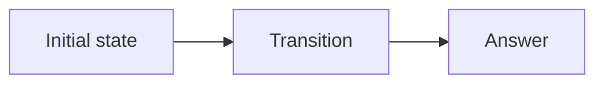

# {{ title }}

> {{ platform }} · {{ difficulty }} · {{ topics }}

[Problem]({{ problem_url }}) · [Python solution](./solution.py) · [Tests](./tests.py)

## Problem overview

Explain the task briefly in original words. State the input, required output, and decisive constraints.

## Intuition

Describe the first reasonable way to think about the problem before presenting advanced machinery.

## Brute-force solution

Explain the literal approach and why it is correct.

```python
# Teaching implementation
```

## Why brute force may fail

Count the repeated operation or oversized state space precisely.

## Key observation

State the invariant, forced choice, or reusable information that removes the bottleneck.

## Optimized approach

Give numbered implementation steps.

<!-- publication-image: assets/diagram.svg -->



## Detailed dry run

| Step | State | Decision | Result |
|---:|---|---|---|
| 1 | ... | ... | ... |

## Correctness proof

State lemmas and prove both soundness (every returned answer is valid) and completeness (a valid answer is not missed).

## Final accepted Python 3 code

```python
class Solution:
    pass
```

## Complexity

- **Time — `O(?)`:** derive the operation count.
- **Space — `O(?)`:** identify every input-sized structure and recursion depth.

## Edge cases and common mistakes

- Smallest input
- Boundary state
- Repeated values or structures
- Off-by-one or mutation mistakes

## FAQ

### Why does the key observation hold?

Answer in plain language, then connect it to the proof.

## Key takeaways

- Reusable pattern
- Diagnostic question for recognizing it again

## LeetCode-ready version

```bash
python3 scripts/generate_publication.py path/to/this/README.md
```
